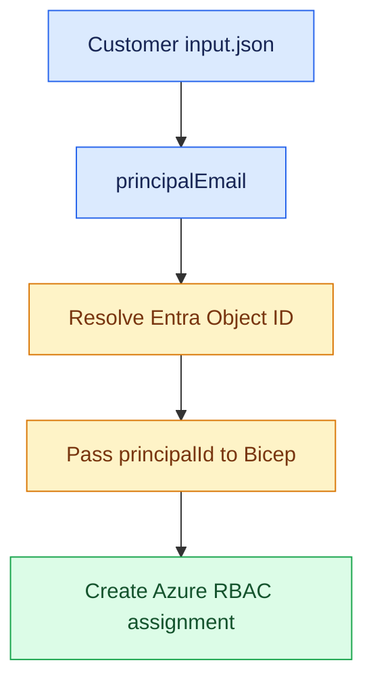
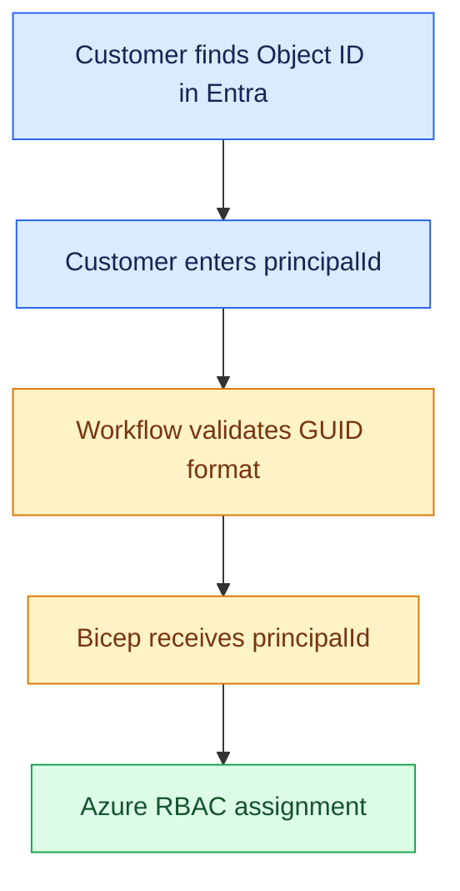
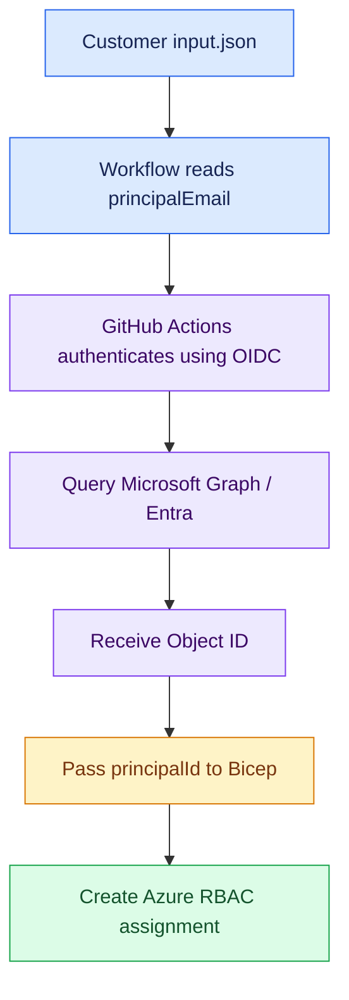

# RBAC Principal Identification – Design Options and Recommendation

> **Project:** BIFROST – Azure RBAC deployment workflow  
> **Purpose:** Explain the current principal lookup issue, compare two options, and recommend a direction for the team.

## 1. Background

The customer supplies RBAC assignments through a client-side `input.json`. Today, the customer identifies the person using `principalEmail`. Azure role assignments, however, require the Entra ID **Object ID** (`principalId`), not an email address.

The workflow therefore needs to resolve the email to an Object ID before passing the value to the relevant Bicep module.



## 2. Current issue

The workflow reads the customer's `principalEmail`, but the Entra user lookup fails with an insufficient-privileges error.

The current lookup uses Azure CLI:

```powershell
az ad user show --id "user@example.com" --query id -o tsv
```

This directory lookup uses Microsoft Graph-backed functionality. The important distinction is that:

- Azure Cloud Shell may run under a person's interactive identity, which has permission to read directory users.
- GitHub Actions runs under the service principal associated with the configured OIDC identity. That identity may not have the necessary Microsoft Graph application permission or admin consent.
- A successful lookup in Cloud Shell does not prove that the GitHub Actions identity has the same directory permissions.
- An empty `mail` attribute does not necessarily prevent lookup if the supplied email matches the user's UPN.

The observed error occurs during principal resolution. It does not, by itself, indicate a Bicep template problem.

## 3. Option 1 – Customer supplies the Object ID

Remove `principalEmail` from the customer input and ask the customer to provide the target user's Entra Object ID directly as `principalId`.

### Example input

```json
{
  "rbac": {
    "resourceGroupAccess": [
      {
        "resourceGroupName": "rg-example-dev-EastUS-001",
        "principalId": "e7dca176-8a24-45af-9df0-429a2c40b023",
        "principalType": "User",
        "roleDefinitionName": "Reader",
        "roleDefinitionGuid": "acdd72a7-3385-48ef-bd42-f606fba81ae7"
      }
    ]
  }
}
```

### How the customer obtains it

1. Open the [Microsoft Entra admin center](https://entra.microsoft.com/).
2. Go to **Identity → Users → All users**.
3. Search for and open the required user.
4. Copy the **Object ID** from the user's Overview or Properties.
5. Provide that value as `principalId` in the input file.

### Processing flow



### Advantages

- No Microsoft Graph user-lookup permission is needed by the GitHub Actions identity.
- Simpler workflow logic and fewer runtime dependencies.
- Smaller directory permission footprint for the deployment identity.
- Bicep receives the identifier Azure RBAC expects.

### Disadvantages

- Adds a manual step for the customer.
- The customer must know how to locate the Object ID.
- Copy/paste mistakes are possible.
- The input is less readable than an email address.
- A valid GUID does not prove that it belongs to the intended person or tenant.

## 4. Option 2 – Microsoft Graph resolves Object ID from email

Keep `principalEmail` in the customer input. The workflow queries Entra directory data through Microsoft Graph and retrieves the matching user's Object ID automatically.

### Example input

```json
{
  "rbac": {
    "resourceGroupAccess": [
      {
        "resourceGroupName": "rg-example-dev-EastUS-001",
        "principalEmail": "user@example.com",
        "principalType": "User",
        "roleDefinitionName": "Reader",
        "roleDefinitionGuid": "acdd72a7-3385-48ef-bd42-f606fba81ae7"
      }
    ]
  }
}
```

### Processing flow



### Required configuration

For an application-permission implementation, the Entra administrator should review and, if approved, configure the following on the app/service principal corresponding to the workflow's `AZURE_CLIENT_ID`:

- **API:** Microsoft Graph
- **Permission type:** Application permissions
- **Permission:** `User.Read.All`
- **Consent:** Tenant-wide admin consent

`User.Read.All` allows the application to read user profiles across the tenant. It is a broad directory-read permission and must be reviewed by the organisation's Entra/security administrators. The workflow must authenticate as the correct service principal and obtain a fresh token after the permission and consent changes.

**Important:** Graph directory-read permission and Azure RBAC deployment permission are separate. Graph permission allows the workflow to look up a user. Creating role assignments also requires appropriate Azure authorization, including `Microsoft.Authorization/roleAssignments/write` at the target scope. These permissions must be assessed independently.

### Advantages

- Customers continue to provide a familiar email address.
- Object ID resolution is automated.
- Reduces customer effort and manual copying errors.
- Fits well with Jira-generated customer input files.
- Scales better when many assignments are requested.

### Disadvantages

- Requires Entra administrator involvement and approval.
- Adds a directory lookup dependency to deployment.
- Lookup can fail if permission, consent, identity, or directory data is incorrect.
- `User.Read.All` has tenant-wide read implications.
- Requires robust handling of lookup errors and unsupported principal types.

### Implementation considerations

- The current implementation supports **User** lookup only. Group and ServicePrincipal lookup need separate logic and testing.
- Ensure the email/UPN identifies exactly one intended user in the correct tenant.
- Log useful lookup and assignment status for auditability, but never log access tokens or secrets.
- Report a failed lookup clearly. Continue processing unrelated entries if that is the agreed workflow behaviour.

## 5. Comparison

| Criteria | Option 1: Customer provides Object ID | Option 2: Microsoft Graph lookup |
|---|---|---|
| Customer input | `principalId` | `principalEmail` |
| Customer effort | Higher | Lower |
| Workflow complexity | Lower | Higher |
| Graph lookup permission | Not needed | Needed |
| Entra admin approval | Usually not needed for lookup | Required for application permission |
| Runtime directory lookup | No | Yes |
| Manual input error risk | Higher | Lower if lookup is unambiguous |
| Directory permission footprint | Smaller | Broader; requires review |
| Scaling many requests | Moderate | Better |
| Input readability | Less user-friendly | More user-friendly |

## 6. Recommendation

### Preferred long-term approach: Option 2 – Microsoft Graph

For BIFROST, **Option 2 is the recommended long-term design**, subject to Entra/security approval and proper implementation.

The workflow is designed around customer/Jira-provided `input.json` files. Email is a natural identifier for customers, while automatic resolution avoids asking each customer to find and copy an Object ID.

Recommended sequence:

1. Customer supplies `principalEmail`.
2. GitHub Actions authenticates using the existing OIDC configuration.
3. Workflow resolves the email to an Entra Object ID through Microsoft Graph-backed lookup.
4. Workflow validates the lookup result.
5. Workflow passes `principalId` to the appropriate Bicep module.
6. Bicep creates the assignment at the requested scope.
7. Workflow records success, failure, or skipped status for each requested assignment.

### Short-term fallback: Option 1

If the organisation cannot approve `User.Read.All`, or approval will take time, use customer-provided `principalId` as an interim approach. Document this as an explicit input contract or fallback rather than silently accepting inconsistent fields.

## 7. BIFROST implementation boundaries

The principal-identification decision is separate from the deployment scope:

- **Subscription access:** subscription-scoped role assignment.
- **Resource group access:** resource-group-scoped role assignment.
- **Resource access:** currently implemented for the supported Storage Account resource template.

The workflow should process the three arrays independently. Missing or empty arrays should be skipped, not treated as failed assignments. A failure for one entry should be reported clearly and should not block unrelated entries if that is the agreed workflow behaviour.

Current principal resolution supports **User** only. Group and ServicePrincipal support must be added and tested before offering those principal types.

## 8. Decision required from the team

1. Should the customer input use `principalEmail` or `principalId`?
2. If Option 2 is selected, will Entra/security approve Microsoft Graph application permission `User.Read.All` for the GitHub Actions application?
3. Which team owns permission approval, admin consent, and periodic review?
4. Should customer-provided `principalId` be allowed as a documented fallback?
5. Is the initial supported principal type limited to User, or must Group and ServicePrincipal also be supported?

> **Proposed decision:** Adopt **Option 2 – Microsoft Graph lookup from `principalEmail`** as the target design. Use **Option 1 – customer-provided `principalId`** as the interim approach if Graph application permissions cannot yet be approved.

## 9. Microsoft references

- [Microsoft Graph overview](https://learn.microsoft.com/graph/overview)
- [Microsoft Graph permissions reference](https://learn.microsoft.com/graph/permissions-reference)
- [Microsoft Graph – List users](https://learn.microsoft.com/graph/api/user-list)
- [Microsoft Entra admin center](https://entra.microsoft.com/)
- [Azure role assignments – Bicep](https://learn.microsoft.com/azure/role-based-access-control/role-assignments-bicep)
