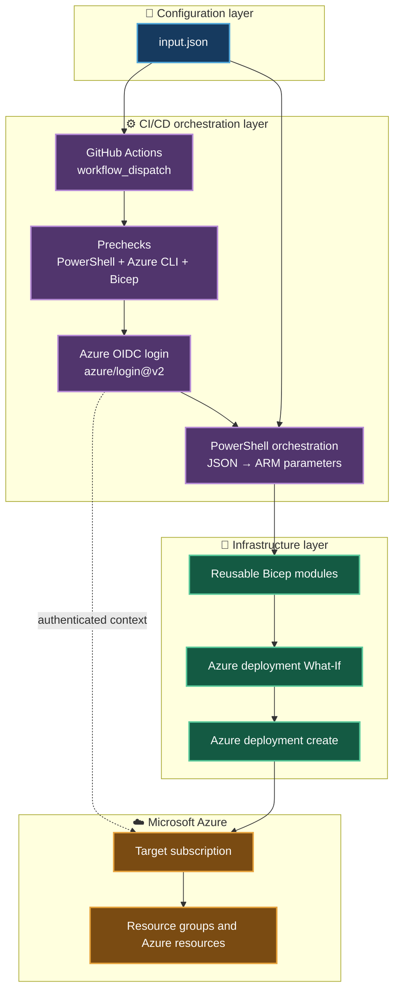
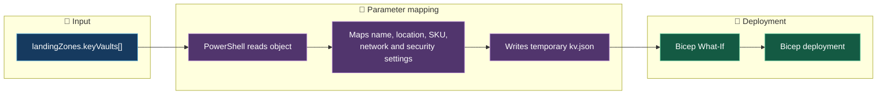
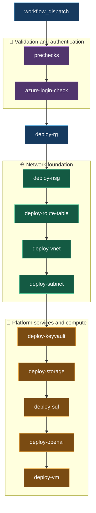
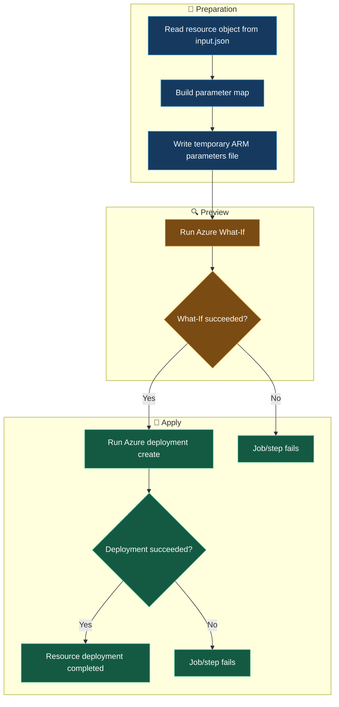

# ❄️ BIFROST_NEW — PIKE Azure Infrastructure Deployment


> **BIFROST_NEW** is a JSON-driven Azure Infrastructure as Code repository for the PIKE workload. It combines GitHub Actions, PowerShell, Azure CLI, reusable Bicep modules and Microsoft Entra workload identity federation (OIDC) to deploy configured Azure resources.

---

## 📚 Table of contents

- [🏗️ Architecture at a glance](#️-architecture-at-a-glance)
- [📁 Repository structure](#-repository-structure)
- [⚙️ Configuration with inputjson](#️-configuration-with-inputjson)
- [🧩 Bicep module catalogue](#-bicep-module-catalogue)
- [🚀 GitHub Actions workflow](#-github-actions-workflow)
- [🔐 Authentication and secrets](#-authentication-and-secrets)
- [🔄 Deployment lifecycle](#-deployment-lifecycle)
- [🧪 Validation and deployment behaviour](#-validation-and-deployment-behaviour)
- [🏷️ Resource naming](#️-resource-naming)
- [🛡️ Security and operational notes](#️-security-and-operational-notes)
- [▶️ Running the workflow](#️-running-the-workflow)
- [🧭 Current limitations and next steps](#-current-limitations-and-next-steps)

---

## 🏗️ Architecture at a glance

The repository follows a configuration-driven, modular deployment approach:

- **Configuration:** `input.json` describes the environment, request metadata, subscription placeholder, deployment location and resource collections.
- **Orchestration:** `.github/workflows/deploy.yml` coordinates validation, authentication and resource deployment.
- **Execution:** PowerShell reads JSON objects, maps their properties to Bicep parameters and writes temporary ARM deployment parameter files.
- **Infrastructure:** Individual Bicep modules define Azure resources.
- **Authentication:** GitHub Actions obtains an OIDC token and authenticates to Azure using `azure/login@v2`.

### High-level architecture



### Scope model

| Deployment | Azure deployment scope | Module |
|---|---|---|
| Resource group | Subscription | `modules/RG/resourcegroup.bicep` |
| NSG, route table, VNet, subnet | Resource group | `modules/networking/*.bicep` |
| Key Vault | Resource group | `modules/security/keyvault.bicep` |
| Storage account and blob resources | Resource group | `modules/storage/storageAccount.bicep` |
| SQL server and database | Resource group | `modules/database/sql.bicep` |
| Azure OpenAI account | Resource group | `modules/ai/openai.bicep` |
| VM and NIC | Resource group | `modules/compute/vm.bicep` |

---

## 📁 Repository structure

The current `main` branch is organised as follows:

```text
BIFROST_NEW/
├── .github/
│   └── workflows/
│       └── deploy.yml
├── modules/
│   ├── RG/
│   │   └── resourcegroup.bicep
│   ├── ai/
│   │   └── openai.bicep
│   ├── compute/
│   │   └── vm.bicep
│   ├── database/
│   │   └── sql.bicep
│   ├── networking/
│   │   ├── nsg.bicep
│   │   ├── routetable.bicep
│   │   ├── subnet.bicep
│   │   └── vnet.bicep
│   ├── security/
│   │   └── keyvault.bicep
│   └── storage/
│       └── storageAccount.bicep
├── input.json
└── README.md
```

> ℹ️ The workflow and module paths above reflect the repository's current `main` branch. There is currently no `modules/main.bicep`, `environments/` directory, `.bicepparam` file or `config/subscriptions.json` in this branch. The deployment is driven by `input.json` and individual module files.

---

## ⚙️ Configuration with `input.json`

`input.json` is the deployment configuration feed. The workflow reads the JSON and selects the relevant collection under `landingZones`.

### Top-level structure

| Property | Purpose |
|---|---|
| `environment` | Environment selector; current workflow accepts `dev` only |
| `request` | Ticket, requester, approval and project metadata |
| `subscription` | Subscription name and a subscription-ID placeholder |
| `deployment` | Deployment-level location |
| `landingZones` | Arrays containing resource configuration objects |

### Current resource collections

The checked-in sample currently has one configured object in each of these ten collections:

| JSON collection | Resource type |
|---|---|
| `resourceGroups` | Resource groups |
| `vnets` | Virtual networks |
| `subnets` | Subnets |
| `nsgs` | Network security groups |
| `routeTables` | Route tables |
| `vms` | Windows virtual machines |
| `keyVaults` | Key Vaults |
| `storageAccounts` | Storage accounts and configured blob containers |
| `sqlDatabases` | SQL logical servers and databases |
| `openAiServices` | Azure OpenAI accounts |

### How a JSON object becomes a deployment

For each configured object, the workflow:

1. Reads the object from its `landingZones` array.
2. Maps JSON fields to the corresponding Bicep module parameters.
3. Creates a temporary ARM parameter JSON file under `$env:RUNNER_TEMP`.
4. Runs `az deployment group what-if` (or subscription What-If for resource groups).
5. Runs the matching `az deployment ... create` command if What-If succeeds.



**Adding another instance:** add another object to the appropriate array and provide all required properties. Ensure referenced resources exist and that names such as `resourceGroupName`, `vnetName`, `subnetName`, `networkSecurityGroupName` and `routeTableName` match the intended resources. The workflow loops over the configured arrays.

---

## 🧩 Bicep module catalogue

Modules are kept separate by Azure resource responsibility. They accept parameters rather than reading `input.json` directly.

| Module | Main responsibility | Notable behaviour |
|---|---|---|
| `RG/resourcegroup.bicep` | Resource group | Subscription-scope resource |
| `networking/nsg.bicep` | Network security group | Builds security rules from an array |
| `networking/routetable.bicep` | Route table | Builds routes from an array |
| `networking/vnet.bicep` | Virtual network | Accepts address prefixes and DNS settings |
| `networking/subnet.bicep` | Subnet | References an existing VNet; optionally associates NSG and route table |
| `security/keyvault.bicep` | Key Vault | Supports RBAC authorization, purge protection and soft-delete retention |
| `storage/storageAccount.bicep` | Storage account | Creates blob service and configured containers |
| `database/sql.bicep` | SQL server and database | Uses a secure administrator password parameter |
| `ai/openai.bicep` | Azure OpenAI | Configures account SKU, custom subdomain and public network access |
| `compute/vm.bicep` | Windows VM and NIC | References an existing VNet/subnet and creates a NIC |

### Module design principles

- 📦 One module per resource responsibility.
- 🔁 Parameter-driven configuration to support multiple instances.
- 🔐 Sensitive password parameters use Bicep `@secure()`.
- 📤 Modules expose useful resource IDs and names through outputs.
- 🧱 Existing-resource references are used where a module depends on infrastructure created elsewhere (for example, VM networking).
- 🏷️ Tags and location are supplied from the configuration object where supported.

---

## 🚀 GitHub Actions workflow

**Workflow file:** `.github/workflows/deploy.yml`

**Workflow name:** `PIKE Modular Azure Infrastructure Deployment`

**Trigger:** Manual `workflow_dispatch`

**Runner:** `[self-hosted, X64, Windows]`

**Permissions:**

- `contents: read` — checkout repository content.
- `id-token: write` — request the GitHub OIDC token used for Azure login.

### Job sequence in the current workflow



### Job responsibilities

| Job | Responsibility |
|---|---|
| `prechecks` | Checks Azure CLI, installs/upgrades Bicep, checks required secrets, builds Bicep files and validates key JSON structure |
| `azure-login-check` | Authenticates with OIDC and verifies the selected subscription |
| `deploy-rg` | Runs subscription-scope What-If and creates configured resource groups |
| `deploy-nsg` | Deploys configured NSGs |
| `deploy-route-table` | Deploys route tables |
| `deploy-vnet` | Deploys VNets; skips a VNet if it already exists to avoid replacing its subnet configuration |
| `deploy-subnet` | Deploys subnets and their NSG/route-table associations |
| `deploy-keyvault` | Deploys Key Vaults using the authenticated tenant ID |
| `deploy-storage` | Deploys storage accounts, blob service and containers |
| `deploy-sql` | Deploys SQL logical servers and databases |
| `deploy-openai` | Deploys Azure OpenAI accounts |
| `deploy-vm` | Deploys Windows VMs and their network interfaces |

Each deployment job checks out the repository, logs into Azure and reads `input.json`. Each resource collection is processed using a PowerShell `foreach` loop.

---

## 🔐 Authentication and secrets

Azure authentication uses GitHub Actions OIDC through `azure/login@v2`. This avoids storing a client secret for the GitHub-to-Azure authentication flow.

Configure the following GitHub Actions secrets. They may be repository secrets or secrets available to the `dev` environment as appropriate.

| Secret | Purpose |
|---|---|
| `AZURE_CLIENT_ID` | Microsoft Entra application/service principal client ID |
| `AZURE_TENANT_ID` | Microsoft Entra tenant ID |
| `AZURE_SUBSCRIPTION_ID` | Target Azure subscription GUID |
| `VM_ADMIN_PASSWORD` | Windows VM local administrator password |
| `SQL_ADMIN_PASSWORD` | SQL administrator password |

### OIDC trust prerequisites

1. Configure a federated identity credential on the Microsoft Entra application/service principal.
2. Ensure its issuer, subject and audience match the GitHub Actions OIDC identity for this repository and the `dev` environment.
3. Grant the service principal the Azure permissions required to create the configured resources at the relevant scopes.
4. Ensure the GitHub Actions environment and required secrets are available to the workflow.

> 🔒 Never commit administrator passwords, client secrets, certificates or other credentials to `input.json`, Bicep files or the repository.

### Subscription ID source

The workflow uses `secrets.AZURE_SUBSCRIPTION_ID` for Azure login and subscription selection. The `subscription.subscriptionId` value in `input.json` is currently a literal placeholder (`${AZURE_SUBSCRIPTION_ID}`); GitHub Actions does not automatically expand environment variables inside JSON. Do not treat that JSON property as the active authentication source.

---

## 🔄 Deployment lifecycle

Each resource deployment follows a preview-then-deploy pattern:



Temporary parameter files are written under the runner's `RUNNER_TEMP` directory. Passwords for the VM and SQL modules are supplied from GitHub secrets as secure Bicep parameters rather than being added to the ordinary JSON parameter object.

---

## 🧪 Validation and deployment behaviour

### Current prechecks

The `prechecks` job currently:

- Checks Azure CLI at `C:\Program Files\Microsoft SDKs\Azure\CLI2\wbin\az.cmd`.
- Installs and upgrades Bicep, then prints its version.
- Checks that VM and SQL passwords and the subscription ID secret are present.
- Checks the subscription ID has GUID format without printing its value.
- Builds every `.bicep` file found under `modules/`.
- Parses `input.json` and checks the environment is `dev`.
- Checks that the resource-group collection is non-empty and the expected resource collections are present.

> ℹ️ Although the job is named “Bicep lint and input validation”, the current workflow runs Bicep **build** commands; it does not currently invoke a separate `az bicep lint` command. JSON validation currently checks required top-level collections, not every field, type, naming rule or cross-resource reference.

### Current failure behaviour

The current workflow uses sequential GitHub Actions jobs with `needs`. A failed job normally causes dependent jobs to be skipped. In addition, a failed What-If or deployment throws an error in the PowerShell step, stopping that step/job.

For example, if `deploy-keyvault` fails, the dependent storage, SQL, OpenAI and VM jobs will not run under the current dependency chain.

The final resource verification job is present only as commented-out YAML. It is not active, and the workflow does not currently generate a final per-resource deployment report artifact.

### Existing-resource handling

The VNet job checks whether the configured VNet already exists. If it does, the workflow skips the VNet template to avoid replacing existing subnet configuration. The subnet job then runs as a separate stage.

---

## 🏷️ Resource naming

The Key Vault, Storage Account and Azure OpenAI modules append a deterministic five-character suffix generated with Bicep `uniqueString()` to a truncated input name.

| Resource | Current module naming behaviour |
|---|---|
| Key Vault | Up to 15 characters from the input name + 5-character suffix |
| Storage account | Up to 19 characters from the input name + 5-character suffix |
| Azure OpenAI account | Up to 20 characters from the input name + 5-character suffix |
| Azure OpenAI custom subdomain | Passed through as configured; no suffix is appended by this module |

The suffix is deterministic for the same subscription, resource group and input name. It is not a random value and is not based on the GitHub Actions run ID.

**Important:** The actual deployed name for these resources may differ from the name in `input.json`. Any later verification or resource-reference logic must account for the final name emitted by the module, rather than assuming the configured input name is the deployed name.

Storage account names must satisfy Azure's lowercase alphanumeric and 3–24 character constraints. Key Vault names must satisfy Azure's 3–24 character constraints. Azure OpenAI account and custom subdomain naming/availability constraints must also be checked for the selected service and region.

---

## 🛡️ Security and operational notes

- 🔐 Keep credentials in GitHub Actions secrets; do not put them in JSON or source files.
- 🪪 Use OIDC federation for GitHub-to-Azure authentication and grant least-privilege Azure RBAC permissions.
- 🧪 Review What-If output before applying infrastructure changes.
- 🌐 The sample NSG has no inbound security rules. The sample VM has no public IP; configure an approved private access path before attempting remote administration.
- 🗄️ The sample SQL configuration disables public network access. Provide an appropriate private connectivity design if clients need to connect.
- 🏷️ Keep resource tags consistent across resource collections.
- 🧾 Treat the input JSON as deployment intent, not proof that a resource was successfully provisioned.
- 🔎 Confirm resource names, region, SKU availability, quota and subscription permissions before running a deployment.

---

## ▶️ Running the workflow

1. Open the repository in GitHub.
2. Review `input.json` and confirm the requested resources, names, locations, tags and cross-resource references.
3. Confirm the `dev` GitHub environment and required secrets are configured.
4. Confirm the Windows self-hosted runner is online and has Azure CLI installed at the path expected by the workflow.
5. Open **Actions** → **PIKE Modular Azure Infrastructure Deployment**.
6. Select **Run workflow** and start the workflow from the intended branch.
7. Review precheck output, Azure login output and each What-If/deployment result.
8. Verify deployed resources in Azure before treating the request as complete.

### Local Bicep build

From a PowerShell terminal at the repository root:

```powershell
$ErrorActionPreference = 'Stop'
$az = 'C:\Program Files\Microsoft SDKs\Azure\CLI2\wbin\az.cmd'

& $az bicep build --file modules/RG/resourcegroup.bicep --stdout
if ($LASTEXITCODE -ne 0) { throw 'Bicep build failed.' }

Get-ChildItem modules -Recurse -Filter '*.bicep' | ForEach-Object {
    & $az bicep build --file $_.FullName --stdout | Out-Null
    if ($LASTEXITCODE -ne 0) { throw "Bicep build failed: $($_.FullName)" }
}
```

This validates Bicep compilation only; it does not authenticate to Azure or deploy resources.

---

## 🧭 Current limitations and next steps

The following are known gaps in the current implementation, not claims that the functionality is already available.

| Area | Current state | Potential next improvement |
|---|---|---|
| Failure isolation | Sequential jobs; a failure can skip downstream jobs | Allow independent resource deployments to continue where dependencies permit |
| Per-resource result tracking | No active consolidated result collector | Track requested, deployed, failed and skipped resources individually |
| Final verification | Verification block is commented out | Activate verification with dependency-aware execution |
| Deployment artifact | No active final report artifact | Generate and upload a JSON/CSV/Markdown deployment summary |
| Input validation | Basic structure checks | Validate object properties, types, allowed values, naming and references |
| Bicep linting | Build is executed; separate lint is absent | Add `az bicep lint` and enforce lint results |
| Resource naming | Some modules transform input names | Capture and consistently use actual deployed names |
| Documentation | This README documents the current checked-in implementation | Keep it updated whenever workflow or module behaviour changes |

### 🎯 Intended future reporting model

The desired report should include every resource requested in `input.json`, including resources that were not deployed.

| Report field | Description |
|---|---|
| Resource type | Azure resource category |
| Requested name | Name supplied in `input.json` |
| Actual name | Final Azure resource name, when known |
| Resource group | Target resource group |
| Status | Deployed, Failed or Skipped |
| Stage | Workflow deployment stage |
| Error/reason | Failure detail or skip reason |
| Timestamp | Deployment/verification time |

A future resilient orchestration design should distinguish **independent resources** from **resources with dependencies**. For example, a VM depends on its NIC and subnet being available; a subnet may depend on its VNet, NSG and route table. A failure should not stop unrelated resources from being attempted, but dependent resources should be marked skipped with a clear reason when their prerequisites are unavailable.

---

<p align="center">
  **❄️ BIFROST_NEW | PIKE Infrastructure as Code**
  <br/>
  <sub>Configuration-driven • Modular Bicep • OIDC-authenticated • Azure-native</sub>
</p>
