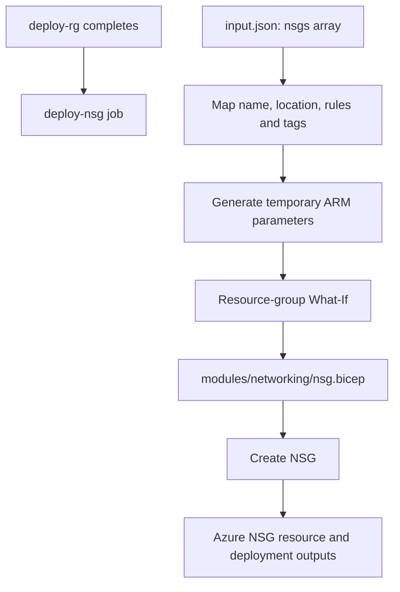

# Network Security Group (NSG) — Module Reference

  

> **Module:** `modules/networking/nsg.bicep`  
> **Workflow job:** `deploy-nsg`  
> **Deployment scope:** Resource-group scope (`az deployment group`)

## 1. Purpose

This reusable Bicep module provisions the network security group (nsg) resource. The workflow reads the resource definition from the root `input.json`, maps the fields to Bicep parameters, creates a temporary ARM parameter file, runs What-If, and then deploys the module.

## 2. Inputs and their sources

The workflow does not pass the whole JSON object directly. It explicitly maps the following fields:

| Bicep parameter | Source / JSON path | Value source |
|---|---|---|
| `location` | `landingZones.nsgs&#91;&#93;.location` | `input.json` |
| `nsgName` | `landingZones.nsgs&#91;&#93;.name` | `input.json` |
| `securityRules` | `landingZones.nsgs&#91;&#93;.securityRules` | `input.json` |
| `tags` | `landingZones.nsgs&#91;&#93;.tags` | `input.json` |

**Secret handling:** No resource-specific password is consumed by this module. 

## 3. Prerequisites and dependencies

- Target resource group must already exist (`resourceGroupName` selects it in the workflow).
- Azure region, NSG name, tags and security-rule array are provided in `input.json`.
- Each rule must provide the fields consumed by the module: `name`, `protocol`, `sourcePortRange`, `destinationPortRange`, `sourceAddressPrefix`, `destinationAddressPrefix`, `access`, `priority`, and `direction`; `description` is optional.
- The deployment identity needs permission to write `Microsoft.Network/networkSecurityGroups` in the target resource group.

### Deployment ordering

Resource group creation is the first provisioning stage.



## 4. Resource naming structure

Exactly the supplied `name` (for example `nsg-pikehex-dev-001`); no suffix is added.

**Important:** The workflow deployment name (for example `pike-...` plus `github.run_id`) is an ARM deployment-history label. It is **not** the Azure resource name. The Azure resource name is determined by the naming rule above.

## 5. Outputs and where to find them

The module declares these Bicep outputs:

| Output name | Meaning |
|---|---|
| `nsgId` | Full Azure resource ID of the NSG. |
| `nsgNameOut` | Actual NSG name. |

Outputs are returned by the ARM deployment operation. The workflow currently invokes `az deployment group create` (or `az deployment sub create` for this subscription-scope module) but does not explicitly export the output object to a GitHub Actions artifact or summary. To inspect it, query the deployment record:

```bash
# Resource-group deployment (replace placeholders)
az deployment group show --resource-group <resourceGroupName> --name <deploymentName> --query properties.outputs -o json

# Subscription-scope deployment (Resource Group module)
az deployment sub show --name <deploymentName> --query properties.outputs -o json
```

`az network nsg show -g <resourceGroupName> -n <nsgName> -o json`. Deployment output: `az deployment group show -g <resourceGroupName> -n <deploymentName> --query properties.outputs -o json`.

### Where to see the resource in Azure Portal

Open **Azure Portal → Resource groups → <target resource group> → <resource>**. For the Resource Group module, open **Subscriptions → <subscription> → Resource groups**. The deployment record and its outputs are available under the relevant scope's **Deployments** history.

## 6. How the workflow calls this module

The `deploy-nsg` job in `.github/workflows/deploy.yml`:

1. Runs after its declared `needs` dependency/dependencies complete.
2. Checks out the repository and authenticates with `azure/login@v2` using OIDC secrets (`AZURE_CLIENT_ID`, `AZURE_TENANT_ID`, `AZURE_SUBSCRIPTION_ID`).
3. Reads `input.json` and loops over `landingZones.<collection>[]`.
4. Maps JSON properties to Bicep parameter names and writes a temporary ARM parameter JSON file under `$env:RUNNER_TEMP`.
5. Runs Azure deployment **What-If** against `nsg.bicep`.
6. Runs Azure deployment **create** if What-If succeeds.

**Job timing:** After `deploy-rg`; before route tables.

| Workflow item | Current implementation |
|---|---|
| Job ID | `deploy-nsg` |
| Display name | See the job's `name` in `.github/workflows/deploy.yml` |
| Template path | `modules/networking/nsg.bicep` |
| Input collection | `landingZones.nsgs&#91;&#93;` |
| Azure CLI operation | `az deployment group what-if`, followed by `create` |

## 7. Operational notes

- The workflow uses a temporary parameter file; it is not committed back to the repository.
- The module's declared outputs are available in Azure deployment history even though the current workflow does not publish them separately.
- Resource deployment names in Azure deployment history are run-scoped labels and should not be confused with resource names.
- A successful What-If is a preview, not proof that the deployment will succeed; Azure policy, provider registration, quota, naming availability and RBAC can still affect deployment.

---

*Reference generated from the `WorkingMark1` branch implementation. If the module or workflow mapping changes, update this reference alongside the code.*
