# Subnet — Module Reference

  

> **Module:** `modules/networking/subnet.bicep`  
> **Workflow job:** `deploy-subnet`  
> **Deployment scope:** Resource-group scope (`az deployment group`)

## 1. Purpose

This reusable Bicep module provisions the subnet resource. The workflow reads the resource definition from the root `input.json`, maps the fields to Bicep parameters, creates a temporary ARM parameter file, runs What-If, and then deploys the module.

## 2. Inputs and their sources

The workflow does not pass the whole JSON object directly. It explicitly maps the following fields:

| Bicep parameter | Source / JSON path | Value source |
|---|---|---|
| `vnetName` | `landingZones.subnets&#91;&#93;.vnetName` | `input.json` |
| `subnetName` | `landingZones.subnets&#91;&#93;.name` | `input.json` |
| `addressPrefix` | `landingZones.subnets&#91;&#93;.addressPrefix` | `input.json` |
| `networkSecurityGroupName` | `landingZones.subnets&#91;&#93;.networkSecurityGroupName` | `input.json` |
| `routeTableName` | `landingZones.subnets&#91;&#93;.routeTableName` | `input.json` |
| `serviceEndpoints` | `landingZones.subnets&#91;&#93;.serviceEndpoints` | `input.json` |
| `privateEndpointNetworkPolicies` | `landingZones.subnets&#91;&#93;.privateEndpointNetworkPolicies` | `input.json` |
| `privateLinkServiceNetworkPolicies` | `landingZones.subnets&#91;&#93;.privateLinkServiceNetworkPolicies` | `input.json` |

**Secret handling:** No resource-specific password is consumed by this module. 

## 3. Prerequisites and dependencies

- The parent resource group and VNet must exist.
- Referenced NSG and route table should exist before subnet association; this workflow creates them earlier.
- `vnetName`, `resourceGroupName`, subnet CIDR, association names and policy settings are from `input.json`.
- Address prefix must be within the VNet address space and not overlap another subnet.
- Identity needs permission to write VNet subnets.

### Deployment ordering

```mermaid
flowchart TD
  A[deploy-vnet completes] --> B[deploy-subnet job]
  C[input.json: subnets&#91;&#93;] --> D[Resolve existing VNet]
  E[Previously deployed NSG] --> F[Subnet association]
  G[Previously deployed route table] --> F
  D --> H[Map subnet parameters]
  F --> H
  H --> I[What-If]
  I --> J[subnet.bicep]
  J --> K[Create subnet under VNet]
  K --> L[Azure Subnet + deployment outputs]
```




## 4. Resource naming structure

Exact `name` from input (example `snet-app-dev-001`); subnet is named under its parent VNet, with no suffix.

**Important:** The workflow deployment name (for example `pike-...` plus `github.run_id`) is an ARM deployment-history label. It is **not** the Azure resource name. The Azure resource name is determined by the naming rule above.

## 5. Outputs and where to find them

The module declares these Bicep outputs:

| Output name | Meaning |
|---|---|
| `subnetId` | Full subnet resource ID. |
| `subnetNameOut` | Actual subnet name. |

Outputs are returned by the ARM deployment operation. The workflow currently invokes `az deployment group create` (or `az deployment sub create` for this subscription-scope module) but does not explicitly export the output object to a GitHub Actions artifact or summary. To inspect it, query the deployment record:

```bash
# Resource-group deployment (replace placeholders)
az deployment group show --resource-group <resourceGroupName> --name <deploymentName> --query properties.outputs -o json

# Subscription-scope deployment (Resource Group module)
az deployment sub show --name <deploymentName> --query properties.outputs -o json
```

`az network vnet subnet show -g <resourceGroupName> --vnet-name <vnetName> -n <subnetName> -o json`; outputs via `az deployment group show ... --query properties.outputs -o json`.

### Where to see the resource in Azure Portal

Open **Azure Portal → Resource groups → <target resource group> → <resource>**. For the Resource Group module, open **Subscriptions → <subscription> → Resource groups**. The deployment record and its outputs are available under the relevant scope's **Deployments** history.

## 6. How the workflow calls this module

The `deploy-subnet` job in `.github/workflows/deploy.yml`:

1. Runs after its declared `needs` dependency/dependencies complete.
2. Checks out the repository and authenticates with `azure/login@v2` using OIDC secrets (`AZURE_CLIENT_ID`, `AZURE_TENANT_ID`, `AZURE_SUBSCRIPTION_ID`).
3. Reads `input.json` and loops over `landingZones.<collection>[]`.
4. Maps JSON properties to Bicep parameter names and writes a temporary ARM parameter JSON file under `$env:RUNNER_TEMP`.
5. Runs Azure deployment **What-If** against `subnet.bicep`.
6. Runs Azure deployment **create** if What-If succeeds.

**Job timing:** After `deploy-vnet`; before Key Vault. This module creates a subnet under an existing VNet.

| Workflow item | Current implementation |
|---|---|
| Job ID | `deploy-subnet` |
| Display name | See the job's `name` in `.github/workflows/deploy.yml` |
| Template path | `modules/networking/subnet.bicep` |
| Input collection | `landingZones.subnets&#91;&#93;` |
| Azure CLI operation | `az deployment group what-if`, followed by `create` |

## 7. Operational notes

- The workflow uses a temporary parameter file; it is not committed back to the repository.
- The module's declared outputs are available in Azure deployment history even though the current workflow does not publish them separately.
- Resource deployment names in Azure deployment history are run-scoped labels and should not be confused with resource names.
- A successful What-If is a preview, not proof that the deployment will succeed; Azure policy, provider registration, quota, naming availability and RBAC can still affect deployment.

---

*Reference generated from the `WorkingMark1` branch implementation. If the module or workflow mapping changes, update this reference alongside the code.*
